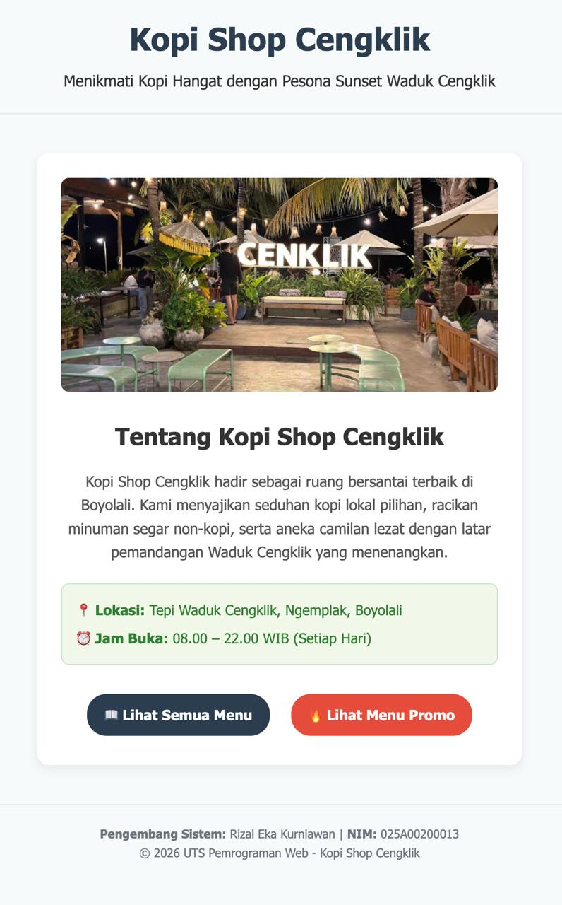
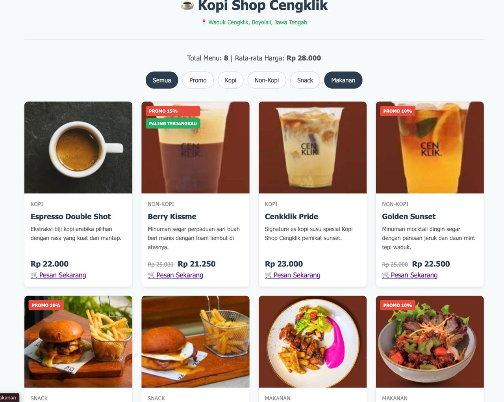
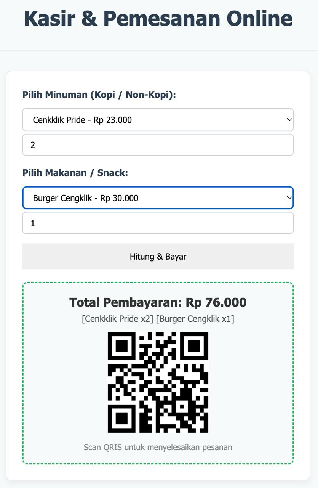

# Kopi Shop Cengklik - Katalog Menu Dinamis & Kasir Pemesanan

Repositori ini berisi proyek web katalog menu interaktif berbasis PHP Native untuk Kopi Shop Cengklik yang berlokasi di area Waduk Cengklik, Boyolali, Jawa Tengah. Dibuat khusus untuk memenuhi tugas Ujian Tengah Semester (UTS) mata kuliah Pemrograman Web.

---

## 1. Identitas Pembuat
- **Nama**: Rizal Eka Kurniawan
- **NIM**: 025A00200013
- **Program Studi**: S1 Informatika
- **Mata Kuliah**: Pemrograman Web (253A23W15)
- **Perguruan Tinggi**: Universitas Tiga Serangkai Surakarta

---

## 2. Deskripsi Tema Proyek
Aplikasi web ini mengangkat tema UMKM kuliner lokal "Kopi Shop Cengklik" yang berlokasi di tepi Waduk Cengklik, Boyolali. Sistem dibangun secara modular tanpa framework dan tanpa basis data (*array-driven structure* menggunakan array multidimensi) untuk menyajikan katalog produk minuman kopi, mocktail, camilan, dan makanan berat secara interaktif, informatif, serta dilengkapi simulasi transaksi kasir pemesanan online langsung.

Aplikasi terbagi menjadi tiga halaman utama:
1. **Halaman Profil (`index.php`)**: Menampilkan identitas mahasiswa, foto profil/lokasi, jam buka kedai, dan tombol navigasi menuju katalog.
2. **Halaman Katalog (`katalog.php`)**: Menampilkan daftar menu makanan, minuman, dan snack secara dinamis lengkap dengan logika perhitungan promo, rata-rata harga, dan filter kategori.
3. **Halaman Kasir Pemesanan (`pesan.php`)**: Formulir transaksi pesanan multi-item sederhana berbasis metode `POST` dengan kalkulasi diskon otomatis dan simulasi pembayaran QRIS dinamis.

---

## 3. Cara Menjalankan di Localhost
1. Buka aplikasi **Terminal** (atau panel terminal bawaan VS Code).
2. Masuk ke direktori utama proyek:
   ```bash
   cd uts-pemwb-025A00200013

```

3. Jalankan server bawaan PHP pada port 8000:
```bash
php -S localhost:8000

```


4. Buka peramban web (*browser*) lalu akses tautan berikut:
* Halaman Profil: `http://localhost:8000/index.php`
* Halaman Katalog: `http://localhost:8000/katalog.php`
* Halaman Kasir Pemesanan: `http://localhost:8000/pesan.php`


---

## 4. Fitur Utama, Berkas, dan Fungsi Penangan

| No | Fitur | Berkas Penangan | Fungsi / Penanganan Logika |
| --- | --- | --- | --- |
| 1 | Halaman Profil & Navigasi | `index.php` | Menyajikan profil kafe, informasi operasional tepi waduk, dan tautan navigasi. |
| 2 | Render Kartu Menu Dinamis | `katalog.php`, `data.php` | Perulangan `foreach` mencetak daftar kartu menu secara otomatis dari array `$menuItems`. |
| 3 | Penyaringan Kategori Dinamis | `katalog.php`, `functions.php` | Fungsi `filterMenuPerKategori()` memproses parameter URL `$_GET['kategori']`. |
| 4 | Perhitungan Diskon Otomatis | `functions.php` | Fungsi `hitungHargaDiskon()` menghitung potongan harga jika item promo aktif. |
| 5 | Pendeteksi Menu Termurah | `functions.php` | Fungsi `cariIdMenuTermurah()` memberikan penanda visual khusus badge **PALING TERJANGKAU**. |
| 6 | Statistik Menu & Rata-rata Harga | `katalog.php`, `functions.php` | Fungsi `hitungRataRataHarga()` menghitung rata-rata nilai harga seluruh menu. |
| 7 | Tampilan Kartu Visual | `style.css` | Tampilan kartu modern dengan layout Grid, foto, badge promo, harga asli yang dicoret, dan harga akhir. |
| 8 | Kasir Pemesanan Multi-Item (Fitur Tambahan) | `pesan.php` | Memproses formulir metode `POST`, menghitung subtotal porsi secara dinamis, dan menampilkan invoice QRIS. |

---

## 5. Daftar Fungsi Bawaan Array (Built-in Array Functions)

Proyek ini mengimplementasikan fungsi array bawaan PHP untuk manipulasi data:

1. **`count()`**: Digunakan pada `katalog.php` dan `functions.php` untuk menghitung total jumlah item menu yang tersedia.
2. **`array_filter()`**: Digunakan pada fungsi `filterMenuPerKategori()` di `functions.php` untuk menyaring array menu sesuai kategori terpilih.
3. **`array_sum()`**: Digunakan pada fungsi `hitungRataRataHarga()` di `functions.php` untuk menjumlahkan seluruh harga menu.
4. **`array_column()`**: Digunakan pada fungsi pencarian statistik untuk mengekstrak kolom data spesifik dari array multidimensi.
5. **`in_array()`**: Digunakan pada `pesan.php` untuk memvalidasi dan memisahkan kategori minuman serta makanan pada elemen `<select>` dropdown.

---

## 6. Teknologi yang Digunakan

* **Bahasa Pemrograman**: PHP (Strict Types enabled)
* **Desain & Styling**: Custom CSS3 (Flexbox & Grid Layout)
* **Manajemen Data**: PHP Array Multidimensi

---

## 7. Struktur Proyek

```text
uts-pemweb-025A00200013/
├── index.php          # Halaman profil kafe, informasi operasional, dan navigasi utama
├── katalog.php        # Halaman katalog menu dinamis, filter kategori, dan statistik
├── pesan.php          # Halaman formulir pemesanan menu multi-item dan pembayaran QRIS
├── data.php           # Penyimpanan data array multidimensi menu kedai
├── functions.php      # Fungsi logika bisnis (hitung diskon, rata-rata, filter, termurah)
├── style.css          # Styling antarmuka responsif, tata letak flexbox dan grid
├── .gitignore         # Berkas pengecualian Git
└── README.md          # Dokumentasi resmi proyek UTS

```

---

## 8. Tangkapan Layar (Screenshots Antarmuka)

### Halaman Beranda & Profil (`index.php`)

### Halaman Katalog Menu Dinamis (`katalog.php`)

### Halaman Kasir Pemesanan Online (`pesan.php`)


---

## 9. Catatan Integritas Akademik & Penggunaan AI

### Sumber Referensi

* Dokumentasi Resmi PHP (https://www.php.net/docs.php) untuk struktur fungsi array dan penanganan tipe data ketat (`declare(strict_types=1)`).
* Mozilla Developer Network (MDN) Web Docs untuk standar CSS Flexbox, CSS Grid, dan semantik HTML5.

### Transparansi Bantuan AI

Dalam pengerjaan proyek ini, AI digunakan secara etis dan bertanggung jawab sebagai sarana diskusi pemecahan masalah teknis:

1. **Penyusunan Logika Transaksi Kasir (`pesan.php`)**: Membantu menstrukturkan pemrosesan formulir `$_POST` dan akumulasi subtotal multi-item berbasis data array tanpa database.
2. **Penerapan Clean Code & Type Hinting (`functions.php`)**: Memastikan deklarasi tipe parameter dan nilai balik fungsi konsisten sesuai anjuran PSR-12.
3. **Troubleshooting Aset & Git**: Membantu menganalisis log HTTP 404 path gambar pada terminal PHP serta konfigurasi berkas sistem `.gitignore` di macOS.

**Metode Pengujian Mandiri:**
Seluruh keluaran kode telah ditelaah, disesuaikan dengan kebutuhan riil proyek Kopi Shop Cengklik, dijalankan secara bertahap pada server lokal, dan diuji keandalannya agar setiap alur logika dapat dipahami serta dipertanggungjawabkan secara penuh saat sesi demonstrasi UTS.

```

*(Catatan: Jika nantinya ketiga file screenshot disimpan di dalam folder `assets/`, cukup ubah path tautan pada bagian tangkapan layar menjadi `assets/screenshot-index.png`, `assets/screenshot-katalog.png`, dan `assets/screenshot-pesan.png`).*

```